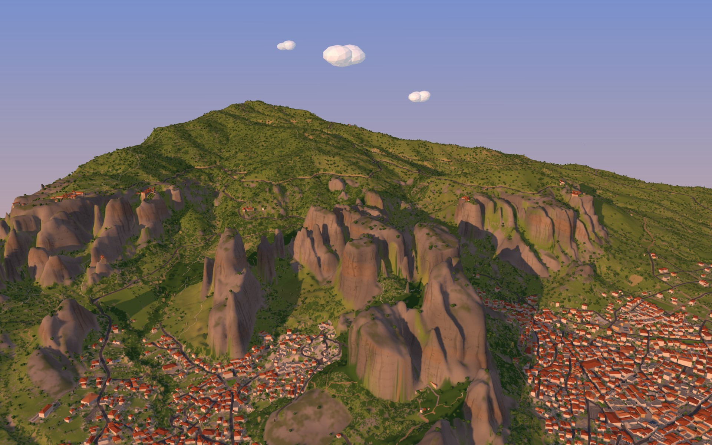
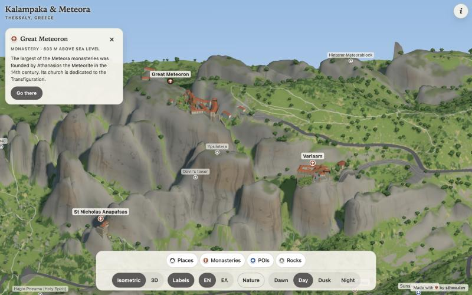

# Kalampaka & Meteora diorama

A 3D model of Kalampaka, Kastraki and the Meteora rocks in Thessaly, Greece, that runs in the browser.



Live demo: https://meteora-diorama.stheo.dev/

It is a static page: plain HTML and JavaScript modules, with [three.js](https://threejs.org) loaded from a CDN.
There is no build step and nothing to install. The tools that prepare the data use only the Python standard
library.



## What is in it

- A 4.2 × 3.8 km block of real terrain on a 4 m grid, with the rock pillars at their true shapes and heights.
- About 3,100 buildings with measured wall heights and roof kinds, and about 14,000 trees at measured positions.
- Twelve hand-built landmarks: the six monasteries, three churches, the town hall, the railway station and the
  museum.
- Roads, paths, squares, fields and ground cover painted on the terrain.
- Pins and labels in English and Greek for 67 places, with filters for settlements, monasteries, points of
  interest and rocks. A pin opens a card with a short description, the place's height and a button that takes you
  there.
- Four times of day (dawn, day, dusk, night), each with its own sun position, light and shadows.
- An isometric and a 3D camera, and a "Nature" layer with clouds, birds, cars, walkers and swaying trees.

## Before you start: the measured data is not in the repository

The page needs three sets of data:

| Folder | What it holds | Source | In the repository |
|---|---|---|---|
| `data/osm.json` | Buildings, roads, names, land cover | OpenStreetMap | Yes |
| `data/pois.json` | Descriptions of 43 places, in English and Greek | Hand-written | Yes |
| `private/` | Terrain, building heights, trees, ground cover | Measured from Google Solar API data | **No** |

`private/` is derived from Google's data, so it is not redistributed here. You build it once on your own machine
with your own Google Maps Platform key (steps below). Without it the page shows a message that the model data
is missing.

## Quick start

You need:

- Python 3.9 or newer (any recent version).
- A Google Maps Platform API key with the **Solar API** enabled. Google bills Solar API requests, so the key's
  project needs billing switched on. Building the whole model makes 24 data-layer requests; check Google's
  current prices before you run it.
- Node 20 or newer, only if you want to run the tests.
- An internet connection: the page loads three.js from a CDN.

### 1. Clone and add your key

```bash
git clone https://github.com/eeVoskos/meteora-diorama.git && cd meteora-diorama
```

Create a file named `.env` in the project folder with one line:

```
GOOGLE_MAPS_KEY=your-key-here
```

`.env` is ignored by git. Never commit it.

### 2. Check the key

```bash
python3 -I tools/probe_google.py
```

This makes one request and downloads no imagery. It prints whether Kalampaka is covered and at what quality.

### 3. Build the model data

```bash
python3 -I tools/fetch_google.py all
```

Downloads the Solar API tiles (surface heights, aerial image, building mask) into `cache/google/`. That is 24
one-kilometre tiles, about 650 MB on disk. Tiles already downloaded are skipped, so you can re-run it after an
interruption.

```bash
python3 -I tools/build_google.py
```

Stitches the tiles and writes `private/` (about 6 MB): the terrain, the height and roof of each building,
buildings the map lacks, trees and ground cover.

### 4. Run it

```bash
python3 -m http.server 8137 --bind 127.0.0.1
```

Then open <http://localhost:8137>. Any static web server works in place of the Python one. Opening
`index.html` straight from disk does not: browsers block the page from loading its data over `file://`.

## Using the page

- Drag to orbit, scroll or pinch to zoom, right-drag or two-finger drag to pan.
- Click or tap a pin to open the card for that place. "Go there" moves the camera to it.
- The bar at the bottom switches between the isometric and the 3D camera, turns pins and labels off and on (with
  a filter per kind), switches between English and Greek, turns the Nature layer on, and sets the time of day.
- The "i" button at the top right shows the data credits.
- `?view=<name>` opens on a named view: `home`, `town`, `rocks`, `church`, `waterfall`, a landmark
  (`great-meteoron`, `varlaam`, `roussanou`, `st-nicholas`, `holy-trinity`, `st-stephen`, `dormition`,
  `agios-vissarion`, `agios-konstantinos`, `town-hall`, `station`, `museum`) or any place id from
  `data/pois.json`, for example `?view=st-barbara`.
- `?time=dawn`, `day`, `dusk` or `night` opens at that time of day. The two combine: `?view=rocks&time=dusk`.

## How it works

```
OpenStreetMap (Overpass) ──► cache/osm/raw.json ──► tools/build_osm.py ──► data/osm.json ─────┐
                              (pinned snapshot)                                               ├─► index.html + src/
Google Solar API ──► cache/google/*.tif ──► tools/google_grid.py ──► tools/build_google.py ──► private/ ─┘
```

- **Coordinates.** Everything is in local metres from an origin at 39.7145° N, 21.6265° E: `x` east, `y` north.
  The block spans x −1840…2400 and y −1980…1836 (`tools/geo.py` and `BLOCK` in `src/geom.js`, which must
  agree). In three.js, X = x, Y = height, Z = −y.
- **Terrain.** `private/heights.bin` is a grid of heights; `src/terrain.js` turns it into one mesh. The ground
  colours are painted on a canvas (`src/ground.js`) from the map's land cover, the measured ground classes and
  the roads, and used as the terrain's texture. Rock faces are textured in the shader.
- **Buildings.** Footprints come from the map. `src/rules.js` decides storeys and roof kind from the measured
  values, or from simple rules where there is no measurement. `src/buildings.js` extrudes them.
- **Places.** `data/pois.json` gives a kind and a short text to places the map already names, and adds others
  as new pins (`src/pois.js`). `src/labels.js` draws the pins and labels; `src/card.js` the card.
- **Landmarks.** Each one is a small hand-written module in `src/landmarks/` that builds its model from shared
  parts (`kit.js`) on the outline the map gives it.
- **Drawing.** The scene is drawn only when something changes; it redraws every frame only while the Nature
  layer is on. The shadow map is drawn once per time of day.

## Project layout

| Path | What it is |
|---|---|
| `index.html` | The page: markup, styles, the import map that pins three.js |
| `src/` | The page's modules. `src/landmarks/` holds the hand-built models |
| `data/osm.json`, `data/pois.json` | The map data and the place descriptions the page loads |
| `private/` | The measured model data (you build it; ignored by git) |
| `tools/` | Python and Node scripts that fetch and build the data |
| `tests/` | Tests for the page's pure logic (`node --test`). `tests/fixtures/` holds a coarse terrain grid they read |
| `docs/reference/visual-reference.md` | Colours, shapes and facts about the real places, with sources |
| `cache/` | Downloaded inputs. Ignored by git, except the pinned map snapshot `cache/osm/raw.json` |
| `dist/` | The assembled site for deployment (ignored by git) |
| `AGENTS.md` | Notes for coding agents and contributors |

## Tools

All Python tools use only the standard library. Run them from the project folder with `python3 -I`.

| Command | What it does |
|---|---|
| `python3 -I tools/probe_google.py [lat lon]` | One Solar API request: is the place covered, at what quality |
| `python3 -I tools/fetch_google.py all` | Downloads the Solar API tiles into `cache/google/` (`sample` fetches one small tile) |
| `python3 -I tools/build_google.py` | Rebuilds `private/` from those tiles |
| `python3 -I tools/build_osm.py` | Rebuilds `data/osm.json` from the map snapshot `cache/osm/raw.json` |
| `python3 -I tools/fetch_osm.py extend` | Adds map data for newly added area to the snapshot without touching what is there |
| `node tools/site-info.mjs <landmark>` | Prints what the map and terrain say about one landmark site |
| `python3 -I tools/build_site.py` | Assembles `dist/`, the folder that gets deployed |

**The map snapshot is pinned.** Many hand-set values (rock outlines, landmark positions and angles) depend on the
exact ids and shapes in `cache/osm/raw.json`. Extend it with the `extend` command; do not re-fetch it from
scratch.

## Tests

```bash
node --test tests/
```

```bash
python3 -I tools/test_tools.py
```

The first needs Node 20 or newer. Neither needs `private/` or a Google key.

## Deploying to Cloudflare

The site deploys as a Cloudflare Worker that serves static files only (`wrangler.jsonc`).

```bash
python3 -I tools/build_site.py
```

```bash
npx wrangler deploy
```

- The first command assembles `dist/` from an allow-list: `index.html`, `src/`, `data/osm.json`,
  `data/pois.json` and `private/`.
  The API key, the downloaded tiles and anything else in the folder are never copied.
- The second uploads `dist/`. Wrangler asks you to log in and which account to use; `wrangler.jsonc` names no
  account. `npx wrangler dev` previews the Worker locally.
- Deploying makes `private/`, which is derived from Google's data, public to anyone with the address. Check
  that this fits the terms of your Google Maps Platform account before you do it.

Any other static host works the same way: upload the contents of `dist/`.

## Making it your own place

The code is written for this one block of Greece, and moving it elsewhere is real work, not a setting:

- The origin and block size live in `tools/geo.py` and `src/geom.js`.
- `tools/fetch_osm.py` holds the map query's bounding box, and `tools/fetch_google.py` the tile grid.
- The landmark models in `src/landmarks/` and many constants in `src/rules.js` are specific to Kalampaka.
- Solar API coverage and quality vary by place: run `tools/probe_google.py <lat> <lon>` first.

## Ideas for later

None of these is built. They are here so nobody has to rediscover them.

- **Phones and other browsers.** The page has only been used in Chrome on a laptop. It draws about 2.4 million
  triangles, which may be too much for a phone; Safari and Firefox are untested.
- **Shareable views.** Put the camera position in the address, so a link opens on exactly what you see.
- **A smooth flight** to a place when you press "Go there", in place of the jump.
- **A guided tour:** a camera path through the six monasteries with their cards.
- **Live weather.** Drive the wind, the clouds and the time of day from the current weather and sun position in
  Kalampaka, using a free weather API.
- **Lit windows at night.**
- **A list of places** to browse and search, next to the pins.
- **Running without a Google key.** The open [2016 Meteora scan](https://zenodo.org/records/10379319) (CC BY 4.0)
  could give the rocks' shapes, so that a clone works out of the box.

## Credits and licences

- The code is under the [MIT licence](LICENSE). The data keeps its own terms:
- Map data © [OpenStreetMap](https://www.openstreetmap.org/copyright) contributors, under the Open Database
  License (ODbL). This covers `data/osm.json` and `cache/osm/raw.json`.
- Terrain, building heights, trees and ground cover are derived from Google Solar API data. That data is not in
  this repository.
- The place descriptions in `data/pois.json` come from the author's Tiny Meteora project.
- `tests/fixtures/heights.*`, a coarse terrain grid used only by the tests, is derived from AW3D30 © JAXA.
- 3D rendering by [three.js](https://threejs.org) (MIT).
